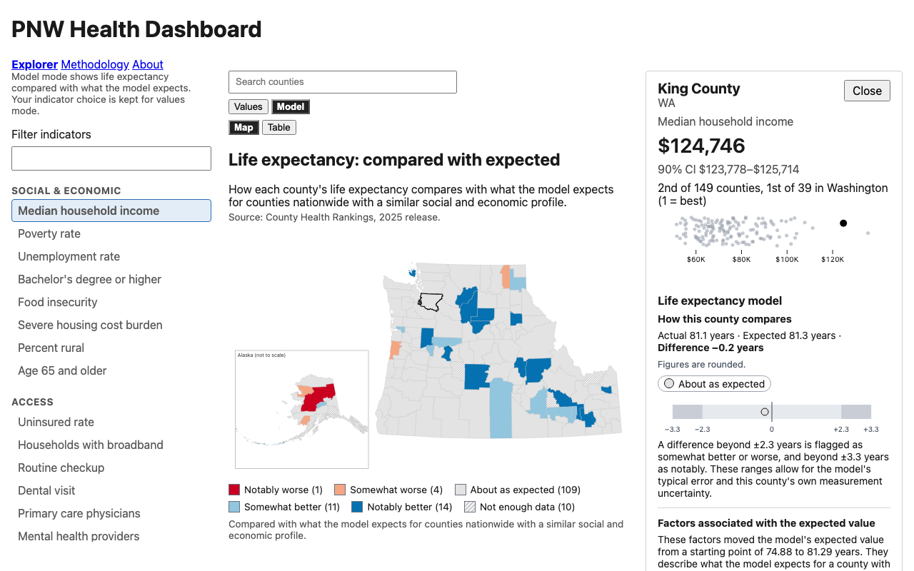
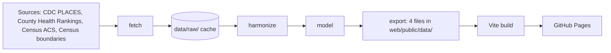

# PNW Health Dashboard

Explore public health data for the 149 counties of Washington, Oregon, Idaho and Alaska, and see how each county's life expectancy compares with what a model expects from its social and economic profile.

[](https://github.com/edward-sf/pnw-health-dashboard/actions/workflows/ci.yml)
[](https://github.com/edward-sf/pnw-health-dashboard/actions/workflows/build-deploy.yml)
[](LICENSE)

**Live site: <https://edward-sf.github.io/pnw-health-dashboard/>**



## What it does

- **Explorer.** A county map and sortable table of health, access and social indicators, with confidence intervals and state and regional ranks. Selecting a county opens a panel with its values and a comparison against the other counties.
- **Model mode.** A model trained on all US counties estimates each county's life expectancy from social and economic factors. The map shows how far the actual value sits above or below the estimate, and the county panel lists the factors associated with the estimate.
- **Methodology.** The [methodology page](https://edward-sf.github.io/pnw-health-dashboard/methodology) covers data sources and vintages, harmonization rules, the model and its card, and the caveats. Read it before drawing conclusions: the factors are associated with the estimate, not shown to cause it.

## Architecture



- **fetch** downloads each source nationally and caches it in `data/raw/`, so reruns skip the network.
- **harmonize** puts every source on one set of county FIPS codes, handles the Alaska county split, and produces a tidy table. Validation aborts the run if the counts or value ranges are wrong.
- **model** trains ridge and LightGBM models with 5-fold cross-validation grouped by state, then computes out-of-fold residuals, flags and SHAP contributions.
- **export** writes `manifest.json`, `values.json`, `counties.topojson` and `model.json`. The three JSON files are checked against JSON Schemas in `schema/`.
- **Vite build and GitHub Pages** produce a static site that reads only those four files. The web app knows nothing about the sources.

## Repo layout

| Path | Contents |
|---|---|
| `pipeline/` | Python 3.12 package (managed with uv): sources, harmonization, model, export, tests |
| `web/` | React and Vite site, unit tests (Vitest) and end-to-end tests (Playwright) |
| `schema/` | JSON Schemas for the three exported JSON files |
| `docs/` | Design specs, plans and review templates |
| `data/raw/` | Cached source downloads (git-ignored) |
| `.github/workflows/` | `ci.yml` (CI) and `build-deploy.yml` (Build and deploy) |

## Run it locally

### Pipeline

Requires [uv](https://docs.astral.sh/uv/) and a free [Census API key](https://api.census.gov/data/key_signup.html), set as `CENSUS_API_KEY` in your environment or in a git-ignored `.env` file at the repo root.

```bash
cd pipeline && uv run pnw-health run --root ..
```

Stages can run separately (`--stage fetch|harmonize|model|export`). Raw downloads are cached in `data/raw/` (use `--refresh` to re-download), and the web artifacts are written to `web/public/data/`.

### Web

```bash
cd web
npm ci
npm run dev
```

### Tests

```bash
cd pipeline && uv run pytest
cd web && npm test              # unit tests
cd web && npm run lint && npm run typecheck
cd web && npm run build && npm run test:e2e   # Playwright
```

To refresh the README screenshot after a data or UI change, run `cd web && npm run screenshot`. It builds the site first.

## Development

Workflow rules are in [CONTRIBUTING.md](CONTRIBUTING.md). Design specs and plans are in [`docs/superpowers/specs/`](docs/superpowers/specs/) and [`docs/superpowers/plans/`](docs/superpowers/plans/).

## License and data credits

Code is released under the [MIT License](LICENSE). The data comes from public sources, each under its own terms:

- [CDC PLACES](https://www.cdc.gov/places/) (Centers for Disease Control and Prevention)
- [County Health Rankings & Roadmaps](https://www.countyhealthrankings.org/) (University of Wisconsin Population Health Institute)
- [American Community Survey 5-year estimates](https://www.census.gov/programs-surveys/acs) and [cartographic boundary files](https://www.census.gov/geographies/mapping-files/time-series/geo/cartographic-boundary.html) (US Census Bureau)

This product uses the Census Bureau Data API but is not endorsed or certified by the Census Bureau.
